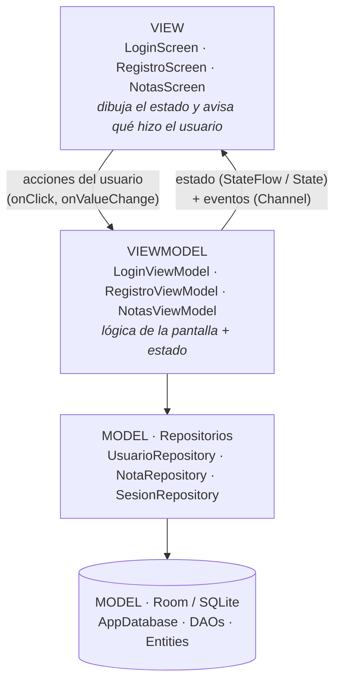

# Arquitectura MVVM — MyNotesApp (Room + Jetpack Compose)

**MVVM** separa la app en tres capas con una sola regla: *cada capa solo conoce a la de abajo*.



## Qué hace cada capa

| Capa | Archivos | Responsabilidad | NO debe hacer |
|---|---|---|---|
| **View** | `ui/views/*Screen.kt`, `ui/components/CampoPassword.kt` | Dibujar el estado; avisar al ViewModel qué pasó; mostrar Toast y animaciones | Validar, llamar a Room, decidir reglas de negocio, conocer el `NavController` |
| **ViewModel** | `ui/viewmodel/*ViewModel.kt` | Guardar el estado de la pantalla, validar, coordinar repositorios | Conocer Compose, Toast, `Context` ni navegación |
| **Model** | `data/repository/*`, `data/room/*` | Guardar y leer datos | Conocer pantallas |

## Estructura del proyecto

```
com.myapp
├── MyApplication.kt          // crea el AppContainer una vez por proceso
├── MainActivity.kt           // solo muestra la UI
├── di/AppContainer.kt        // crea base de datos + repositorios (inyección manual)
├── navigation/Navigation.kt  // único lugar que conoce el NavController
├── data/
│   ├── room/                 // Entity · Dao · AppDatabase   (SQLite)
│   └── repository/           // UsuarioRepository · NotaRepository · SesionRepository
├── ui/
│   ├── viewmodel/            // LoginViewModel · RegistroViewModel · NotasViewModel · AppViewModelProvider
│   ├── views/                // LoginScreen · RegistroScreen · NotasScreen
│   ├── components/           // CampoPassword
│   └── theme/
└── utils/Validaciones.kt
```

## Recorrido de un caso: "el usuario toca *Ingresar*"

1. **View:** `Button(onClick = viewModel::ingresar)` — solo avisa, no decide nada.
2. **ViewModel:** valida los campos. Si hay un error, actualiza `uiState.error`.
3. **ViewModel → Model:** `usuarioRepository.autenticar(email, password)` (consulta a Room en una corrutina).
4. **ViewModel:** si es correcto, `sesionRepository.iniciar(email)` y envía el evento `LoginExitoso`.
5. **View:** `LaunchedEffect` recoge el evento → muestra el Toast y llama a `onLoginExitoso()`.
6. **Navigation:** esa lambda hace `navController.navigate("notas")`.

La pantalla nunca supo *cómo* se valida ni *dónde* están los usuarios.

## Estado vs. eventos

| | Qué es | Ejemplo | Cómo viaja |
|---|---|---|---|
| **Estado** | Lo que la pantalla *es* en este momento. Siempre tiene un valor. | texto escrito, mensaje de error, lista de notas, diálogo abierto | `StateFlow` (Login, Notas) o `State` de Compose (Registro) |
| **Evento** | Algo que ocurre *una sola vez*. | mostrar un Toast, navegar | `Channel` → `Flow` |

Si un evento fuera estado, al rotar el teléfono se volvería a ejecutar (otro Toast, otra navegación).

## StateFlow vs. State (comparar Login y Registro)

| | `LoginViewModel` | `RegistroViewModel` |
|---|---|---|
| Declaración | `MutableStateFlow` privado + `StateFlow` público | `var uiState by mutableStateOf(...)` con `private set` |
| Lectura en la pantalla | `collectAsStateWithLifecycle()` | directo: `viewModel.uiState` |
| Depende de Compose | No | Sí |
| Cuándo usarlo | Lógica reutilizable / testeable sin Compose | Estados simples solo de UI |

## Qué cambió respecto a la versión anterior

| Antes | Ahora |
|---|---|
| `AppState` hacía todo: base de datos, sesión, listas en memoria y lógica | Repartido en 3 repositorios + 3 ViewModels, cada uno con una responsabilidad |
| Las pantallas llamaban a `appState.login()`, `appState.agregarNota()`… | Las pantallas llaman al ViewModel; el ViewModel llama al repositorio |
| Copia de las notas en memoria, sincronizada a mano con Room | Room emite la lista con un `Flow`: la pantalla siempre refleja la base de datos |
| Las pantallas recibían `NavController` | Reciben lambdas (`onLoginExitoso`, `onVolver`…); solo `Navigation.kt` navega |
| `MainActivity` creaba la base de datos | `MyApplication` crea un `AppContainer`; los ViewModels reciben sus dependencias con `AppViewModelProvider` |
| Estado de diálogos y animación de borrado dentro de la pantalla | En `NotasUiState`, dentro del ViewModel |

## Por qué existe `MyApplication`

Los repositorios (sobre todo `SesionRepository`, que guarda quién inició sesión) deben ser **una sola instancia para toda la app**. Si se crearan en la `Activity`, al rotar el teléfono se crearían de nuevo y la sesión se perdería. La clase `Application` se crea una vez por proceso, por eso el `AppContainer` vive ahí (declarada en `AndroidManifest.xml` con `android:name=".MyApplication"`).
